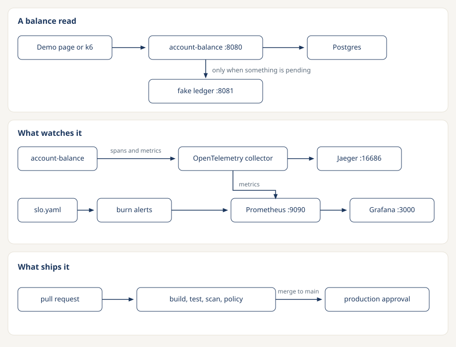

# Account balance golden path

Prepared by Minenhle Sibanda for the Sun International Senior SRE practical assignment.

This repo is the kit a product team would pick up, with the Accounts balance read API onboarded onto it. The service is small on purpose. The thing to review is the golden path: one SLO spec, the telemetry rules, the runbook, and the pipeline gate that makes those three mandatory.

## How it fits together

A caller asks the balance service. The service reads Postgres. It asks the ledger only when that account has something pending. If the ledger fails, the read still returns the settled balance and says so.



## Run it

Docker is enough. From this directory:

```bash
docker compose up --build
```

| What | URL |
| --- | --- |
| Balance API | http://localhost:8080 |
| Balance page | http://localhost:8080/demo |
| Fake ledger switch | http://localhost:8081/control |
| Prometheus alerts | http://localhost:9090/alerts |
| Grafana (anonymous, local only) | http://localhost:3000/d/balance-read |
| Jaeger | http://localhost:16686 |

Seeded accounts, amounts in rand:

| Account | Settled | What is pending | Available when the ledger confirms |
| --- | --- | --- | --- |
| `acc_1001` | 1500.00 | 50.00 hold | 1450.00 |
| `acc_1002` | 25.00 | nothing | 25.00, and the ledger is not called |
| `acc_1003` | 0.00 | 100.00 deposit | 0.00 until that deposit settles |

```bash
curl http://localhost:8080/accounts/acc_1001/balance
curl "http://localhost:8080/accounts/acc_1001/transactions?limit=20"
```

If you change `db/init.sql`, reset the database volume with `docker compose down -v` before the next `up`.

## Show the ledger incident

The ledger can be told to fail, stall, reject its token, or fail 10% of calls:

```bash
python scripts/demo_fault.py
python scripts/demo_fault.py --reset
```

The same two actions are buttons on http://localhost:8080/demo. The page log is the script output. It does not run any other command.

`demo_fault.py` sets intermittent 10% errors and calls `acc_1001` for about three minutes. Reads should stay HTTP 200. Some bodies come back `degraded: true` with the settled balance and `warning: pending_not_applied`. That is the mitigation: we do not fail the page, and we do not pretend the hold was confirmed.

The alert that should fire is `AccountBalanceReadLedgerConfirmErrorRateHigh`. It is on the ledger's error ratio, not on the customer SLO. The SLO should stay quiet if the mitigation is working. Give Prometheus the three minutes; the rule waits for a 2 minute rate and then 1 minute.

After a burst of failures the breaker stays open for 30 seconds. A curl in that window still comes back degraded even if you have already reset the ledger. Wait, then read `acc_1001` again: available should be 50.00 below settled, and `degraded` should be false.

The same expressions are proven without waiting, with synthetic series:

```bash
docker run --rm --entrypoint promtool -v "%cd%/golden-path/slo:/rules" prom/prometheus:v2.55.1 test rules /rules/promtool/burn.test.yml
```

On macOS or Linux, replace `%cd%` with `$PWD`.

Load, shaped like the ticket but scaled down so a laptop survives. Production steady is 150 requests/s and the Sunday 16:30 peak is 1500. The default here is 30:

```bash
docker compose --profile load run --rm k6
docker compose --profile load run --rm -e SCENARIO=spike -e RATE=150 k6
```

## Tests

```bash
pip install -r requirements-dev.txt
python -m pytest -q
python golden-path/slo/generate.py --check
python scripts/policy_gate.py
```

Postgres is covered when the stack is up:

```bash
docker compose --profile test run --rm integration-tests
```

## Adopt the kit

You already own the service. The platform owns the path. To put a new service on it:

1. Copy `services/account-balance/slo.yaml`. Set `service`, `owner`, `environment`, `cost_centre`, the route, and the target. One file is the whole SLO. Then run `python golden-path/slo/generate.py` and commit the generated rules. Do not hand-edit the rules.
2. Start OpenTelemetry the way `services/account-balance/app/telemetry.py` does. Follow `golden-path/telemetry/STANDARD.md`. Metrics are not sampled. Traces are. Account ids are not labels.
3. Copy `golden-path/runbooks/TEMPLATE.md` and fill it for the dependency that will actually wake someone up. Keep Mitigate separate from Fix.
4. Extend `golden-path/pipeline/azure-pipelines.yml` instead of writing your own build. The policy gate fails the build if the spec, the runbook, or the telemetry rules are missing. Production is an approval on the pipeline environment. This repo does not deploy anywhere.

The balance service in this repo is already onboarded that way. `services/account-balance/slo.yaml` is the spec. The runbook for the ledger failure is `services/account-balance/runbooks/ledger-degraded.md`.

## The SLO, in one place

99.9% of balance reads succeed in under 200ms, measured over a rolling 30 days. That is an error budget of 0.1%, about 43 minutes if the read is fully down. Client errors (4xx) are not in the budget. A 5xx is. A 200 that took longer than 200ms is.

Three burn alerts, both windows required:

| Alert | Windows | Burns when |
| --- | --- | --- |
| FastBurn, page | 5m and 1h | about 2% of the 30-day budget in an hour |
| MediumBurn, page | 30m and 6h | about 5% in six hours |
| SlowBurn, ticket | 6h and 3d | about 10% in three days |

The ledger page is separate, and it is the one this incident is supposed to hit.

## Layout

```
services/account-balance/     the read API, its SLO spec, its runbook
services/fake-ledger/         dependency double, with a misbehave switch
golden-path/slo/              spec in, Prometheus rules out
golden-path/telemetry/        the standard, collector, Prometheus, Grafana
golden-path/runbooks/         the one-page template
golden-path/pipeline/         Azure Pipelines template
load/                         k6 profile
scripts/                      policy gate and the ledger drill
DECISIONS.md                  what was chosen, what was not, what it costs
```

Decisions, assumptions, the two parts of the kit that are designed and not built, and the cost estimate are in [DECISIONS.md](DECISIONS.md).
