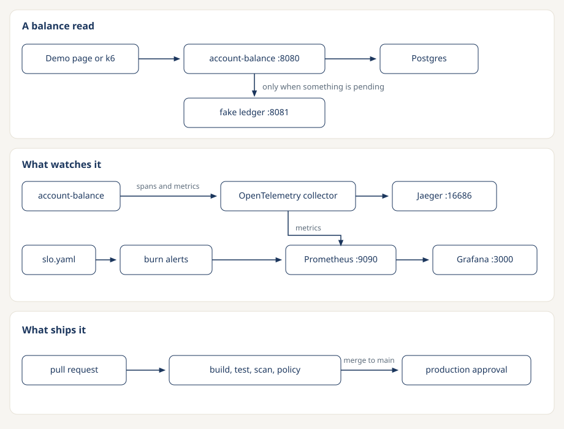

# Review script

This is the brief, turned into things you can show. It is a presenter map. The product-team guide stays in README.md.

Start the hour with this picture, then walk the boxes.

When the ledger box fails, the balance box still answers. That is the mitigation.

## The service

- [ ] Balance read and transaction list. Open http://localhost:8080/demo, choose `acc_1001`, and press Read balance. Confirmed, R1450.00, settled R1500.00. The same read as JSON: `curl http://localhost:8080/accounts/acc_1001/balance`. Transactions: `curl "http://localhost:8080/accounts/acc_1001/transactions?limit=20"`.
- [ ] `acc_1002` is R25.00 and the ledger is not called. `acc_1003` is R0.00 because the deposit is not spendable yet.
- [ ] Postgres holds the balances. It comes up with `docker compose up --build`. Seed data is in `db/init.sql`.
- [ ] The fake ledger can fail on purpose. `python scripts/demo_fault.py --mode error` then read `acc_1001` again. The page stays up, shows R1500.00, and says pending amounts were not applied. `--reset` puts the ledger back. The breaker stays open for 30 seconds after a burst.
- [ ] Load is `docker compose --profile load run --rm k6`. Steady production shape is 150 requests/s, Sunday 16:30 is 1500. The laptop default is 30.
- [ ] Tests: `python -m pytest -q` and `docker compose --profile test run --rm integration-tests`.

## The golden path

- [ ] One SLO spec generates the alerts. Show `services/account-balance/slo.yaml`, then `golden-path/slo/generated/account-balance.yml`. Say: a new service is one spec file, then `python golden-path/slo/generate.py`. Do not hand-edit the generated file. `python golden-path/slo/generate.py --check` fails if they differ.
- [ ] The promise: 99.9% of balance reads succeed in under 200ms over 30 days. About 43 minutes of full outage. FastBurn and MediumBurn page. SlowBurn is a ticket. 4xx is outside the budget. A 5xx or a read slower than 200ms spends it.
- [ ] The alert rules are proven without waiting: `docker run --rm --entrypoint promtool -v "%cd%/golden-path/slo:/rules" prom/prometheus:v2.55.1 test rules /rules/promtool/burn.test.yml`.
- [ ] Telemetry standard is `golden-path/telemetry/STANDARD.md`. Metrics are not sampled. Traces are. Account ids are not labels. Local proof: Grafana http://localhost:3000/d/balance-read, Prometheus http://localhost:9090/alerts, Jaeger http://localhost:16686.
- [ ] Runbook template is one page: `golden-path/runbooks/TEMPLATE.md`.
- [ ] The pipeline is the optional piece that was built. `golden-path/pipeline/azure-pipelines.yml` and `.github/workflows/reusable-service.yml`: build, test, scan, policy gate, and a deploy job that waits for the production environment. `python scripts/policy_gate.py` is that gate locally. The last green run is the scan fix on main.
- [ ] Edge and the Azure module are designs, half a page each, in DECISIONS.md under "Edge and security (not built)" and "Azure module (not built)".

## The incident they asked for

- [ ] The ledger returns errors. The alert that fires is `AccountBalanceReadLedgerConfirmErrorRateHigh`, because the ledger's error ratio is the signal. The customer SLO stays quiet when the mitigation holds.
- [ ] The mitigation is in the service: one attempt, 80ms timeout, no retry, breaker open for 30 seconds, HTTP 200 with the settled balance and `degraded: true`.
- [ ] The filled runbook is `services/account-balance/runbooks/ledger-degraded.md`. Show Mitigate, then Fix, then Verify.

## What you wrote for the product team

- [ ] README.md, section "Adopt the kit": one spec, the telemetry standard, one runbook, the shared pipeline.
- [ ] DECISIONS.md: what was rejected, what was kept small, where AI helped, assumptions, the cost estimate, the two unbuilt parts, gaps, and one more sprint.

## If they ask

There is no Jira project and no ServiceNow. The brief is the ticket. SlowBurn's severity `ticket` means a low-urgency alert, not an ITSM tool. Nothing is deployed. The production job is the approval gate.
